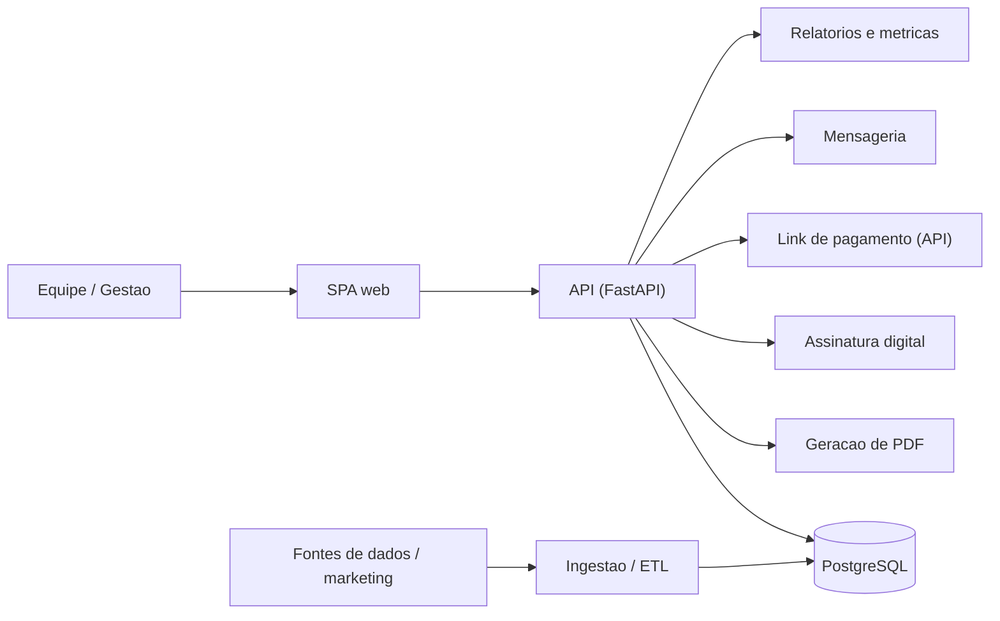

# Quasar — SaaS de atendimento e gestão comercial

Case study de um **SaaS de atendimento** que projetei e construí de ponta a
ponta: gestão do funil comercial, **geração de documentos (PDF)**, **assinatura
digital**, **link de pagamento via API**, gestão de dados e **métricas de
relatório**.

> Este repositório é uma **vitrine** do produto — o que ele faz e como é
> arquitetado. O código-fonte é **proprietário e privado**; nada de credencial,
> dado de cliente ou segredo aparece aqui. Prints, quando houver, usam dados
> fictícios.

## O que o Quasar faz

- **Atendimento e funil comercial** — ciclo do lead de ponta a ponta (entrada,
  distribuição, acompanhamento, fechamento), em quadro visual (kanban) e tabela.
- **Geração de documentos (PDF)** — contratos, propostas e termos montados a
  partir de modelos configuráveis, com os dados do cliente preenchidos.
- **Assinatura digital** — envio e acompanhamento da assinatura dos documentos,
  integrado ao fluxo do funil.
- **Cobrança por API** — geração de **link de pagamento** e conciliação do
  status (pago/pendente) direto com o provedor.
- **Gestão de dados** — ingestão de múltiplas fontes, deduplicação e organização
  dos registros; múltiplas bases por domínio.
- **Relatórios e métricas** — números do funil, do financeiro e de origem de
  marketing, para a gestão decidir com dado na mão.

## Stack

- **Backend:** Python · FastAPI
- **Banco:** PostgreSQL (múltiplas bases por domínio)
- **Frontend:** SPA em JavaScript
- **Integrações:** provedores de pagamento, assinatura digital e mensageria,
  todos por API

## Arquitetura (visão geral)

## Destaques de engenharia

- Aplicação servida por uma API única em FastAPI sobre PostgreSQL, com a lógica
  de estado sensível concentrada no banco (consistência garantida na fonte).
- Ingestão de dados de várias origens com deduplicação, alimentando o funil sem
  intervenção manual.
- Documentos gerados no servidor a partir de modelos, com as integrações de
  assinatura e pagamento acopladas ao estágio certo do funil.
- Relatórios construídos sobre o mesmo recorte de dados das telas operacionais —
  a gestão vê o mesmo número que a operação.

## Capturas de tela

As capturas (com **dados fictícios**) ficam em [`docs/screenshots/`](docs/screenshots/).
_A adicionar._

---

_Autoria e desenvolvimento: **Morigan Ventrici** — [GitHub](https://github.com/morigan-cybsec). Produto proprietário; este repositório documenta o projeto, sem expor código-fonte, dados ou segredos._
